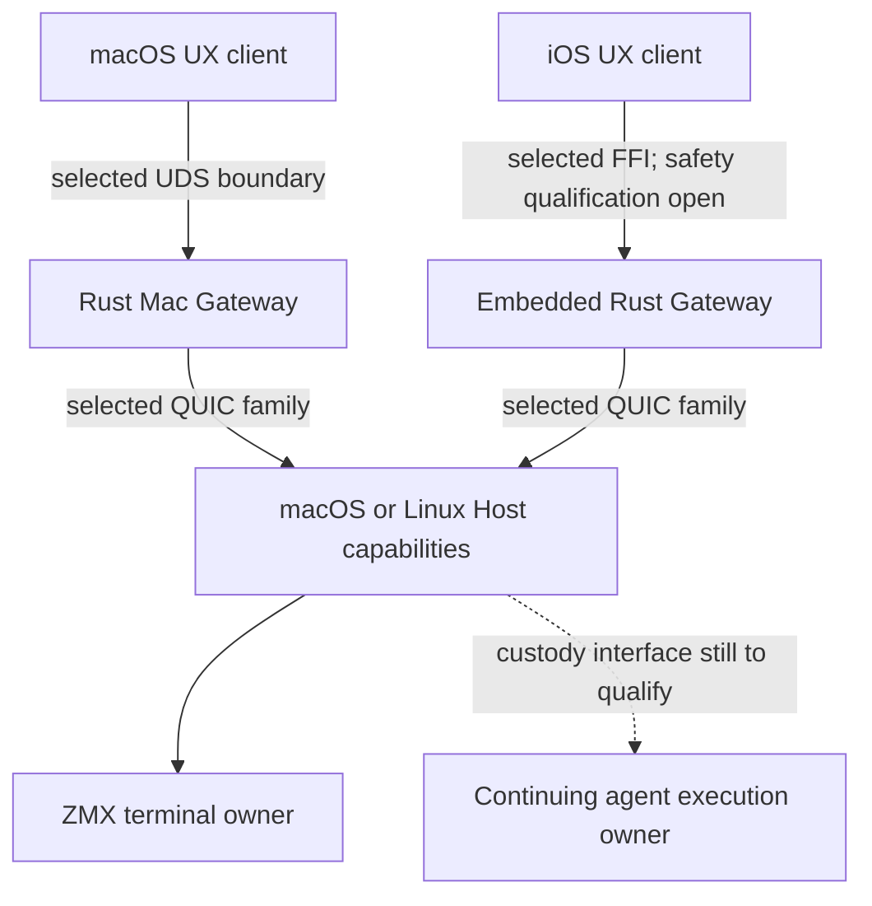

# AgentStudio daemon: what can continue and what still needs proof

**Continue design and source reconciliation. The Router control facade is useful upstream work; it does not complete AgentStudio's daemon migration or authorize this worktree to implement it.** This package is for the Station Chief to consolidate for Sun. No new owner decision is requested by this checkpoint.

## Current picture

The AgentStudio target remains a Rust Host on macOS/Linux and a Rust Gateway on macOS/iOS. Each capability needs one authoritative owner; the Gateway routes to Hosts and prepares qualified client views; the native app owns presentation, input and actual native effects. The CLI has both frontend operations through a Gateway and machine-local worktree operations through its local Host. Remote deployment-to-workspace cardinality remains deliberately open.

This is a projection of the selected boundaries and open custody proposal, not a diagram of implemented services. It omits browser content, fleet admission and central writer-lease authority to focus on execution control; those remain separately owned contracts. The [integrated workbench](/Users/shravansunder/code/projects/agentstudio.feat-daemon/docs/specs/2026-10-15-agentstudio-daemon/designs/11-operations-integration/program-design-workbench.md) owns the broader structural proposal.

## What changed upstream

The inspected Router design is `8ea764174ea80c7715c73c9bf918a39980307b03` in `codex-router.feat-acp-cli-actions`.

| Topic | Current source/design statement | Consequence for this effort |
| --- | --- | --- |
| Provider and frontend independence | Existing session and richer application-operation routes converge on Host execution owners; pure provider rules stay below protocol adapters | Reuse the actual contracts without a second provider executor for each frontend |
| Incoming ACP | The design now selects a provider-bound local standard profile plus the existing Router-aware multiplexed profile | The old “initial profile unselected” research statement is historical; local owner binding does not solve remote pairing |
| MCP | The recorded owner direction selects ordinary MCP tools over existing capabilities; no ACP-message tunnel | Keep control methods typed and intentional; client-supplied tool servers and incoming MCP control are different concepts |
| First deliverable | Current facade plan records operator control → controlled lifecycle proof → real provider/original CLI proof → one PR ready and unmerged | A new bound listener is not required before that facade; this delivery remains with the Router Lead |
| Prior steering finding | Expected-turn condition was lost after a snapshot check; M2 carries a target/outcome design gate and a held proof obligation | Preserve exact targeting through the effect owner; do not call the unrun countercase a runtime reproduction |

The [current Router interface design](/Users/shravansunder/code/projects/codex-router.feat-acp-cli-actions/docs/specs/2026-11-02-acp-shared-control/interface-design.html), [MCP facade](/Users/shravansunder/code/projects/codex-router.feat-acp-cli-actions/docs/specs/2026-11-02-acp-shared-control/mcp-facade.html) and [first facade plan](/Users/shravansunder/code/projects/codex-router.feat-acp-cli-actions/docs/specs/2026-11-02-acp-shared-control/plans/2026-11-05-mcp-facade-proof-boundaries.html) own that work. The refreshed [daemon reuse note](/Users/shravansunder/code/projects/agentstudio.feat-daemon/docs/specs/2026-10-15-agentstudio-daemon/research/2026-11-02-acp-control-reuse.md) keeps the historical evidence and current distinctions together.

This is a source check, not a fresh whole-design review or implementation verdict. No committed crates/scripts/Cargo delta was present between the inspected Router design tree and its recorded `82a0d53bb` product base. The new plan names other implementation applicability and narrower F1/F2 evidence; those worktrees, actual providers, CI and installed services were not checked here.

## Evidence and remaining gaps

| Claim | Evidence available | Still needed |
| --- | --- | --- |
| Control requester may disappear while a native turn continues | The retained November 1 experiment observed a real command and the same native turn completing after the requesting CLI was killed, with a separate observer retained | Real Studio Host replacement, last-observer loss, provider-process incarnation, pending interaction custody and target/provider coverage |
| First-party unsafe remains forbidden, including generated scaffolding | Initial profile IP6 and the frozen native-binding check: ordinary UniFFI 0.32.1 generated unsafe exports despite green forbid/clippy checks | A qualified external ABI host used through safe first-party interfaces, or an explicit owner change to the binding-only safety profile |
| Every existing capability has a migration home | Existing feature tree, operation crosswalk and storage-placement census are recorded | Complete structural contracts, per-increment admission and actual migrated behavior; survey rows are not completed features |
| Whole-system readiness | The root index explicitly marks Program Design incomplete and whole-system Verification Design unauthored | Finish the affected structural contracts, then map each obligation to its real target, sensitivity and evidence |

The [native result](/Users/shravansunder/code/projects/agentstudio.feat-daemon/docs/specs/2026-10-15-agentstudio-daemon/research/2026-11-01-system-boundaries/native-continuity-results.md), [continuity qualification](/Users/shravansunder/code/projects/agentstudio.feat-daemon/docs/specs/2026-10-15-agentstudio-daemon/research/2026-11-01-system-boundaries/continuity-qualification.md), [binding check](/Users/shravansunder/code/projects/agentstudio.feat-daemon/docs/specs/2026-10-15-agentstudio-daemon/increments/00-qualification/bridge-gateway-transport/native-binding-safety.md) and [root design index](/Users/shravansunder/code/projects/agentstudio.feat-daemon/docs/specs/2026-10-15-agentstudio-daemon/index.md) carry their exact scope. These are retained observations and current design gaps, not new runtime results.

## Alternatives and recommendation

For control reuse, the recorded direction is to share actual operation/session ownership and keep thin frontend adapters. Reimplementing execution per frontend would create competing lifecycle/authority truth; an ACP tunnel would also contradict the recorded Router facade direction. Reusing those owners costs explicit representation, capability and result mapping in the consuming adapter, which the Router and daemon integration owners must qualify.

For planned Host upgrades, importing a whole-Host teardown unchanged cannot establish the selected continuing-turn outcome. The continuing-custody candidate keeps the execution owner outside the replaced lifecycle, at the cost of a real handover, interaction and event-recovery contract. Recommend qualifying that boundary before treating a source-level reuse seam as a service-deployment decision.

For iOS bootstrap, preserve IP6 now. A genuinely external ABI host would need identification and proof; relabelling a first-party binding crate is insufficient. A binding-only generated-unsafe exception would require an explicit owner policy change and a defined audit boundary. Recommend continuing the compliant-host investigation before asking the owner to relax the rule. No qualifying candidate or policy exception is claimed, and the existing ordinary UniFFI candidate stays blocked under the literal profile.

The additional [two-path source check](/Users/shravansunder/code/projects/agentstudio.feat-daemon/docs/specs/2026-10-15-agentstudio-daemon/research/2026-11-05-ios-abi-host-source-check.md) found no qualified replacement: Tauri's normal mobile entry emits a consumer unsafe export, while Winit's ordinary run path owns UIKit startup. This narrows the search without proving other embedding approaches impossible or selecting a different app lifecycle. No iOS integration was run.

## What continues and what waits

- Continue reconciling current upstream contracts and the hierarchical capability/operation map. Existing Mac socket, Linux Host, browser-content and pure typed-contract design do not depend on relaxing the iOS rule.
- Continue the affected execution-custody and storage/view contract design. Their verification inputs can be prepared; whole-system Verification Design cannot be called complete while those meanings remain open.
- Leave Router implementation, provider proof, PR/merge handling and its own admitted delivery plan with the Router Lead. This package grants no takeover or production authority.
- The iOS ordinary binding candidate waits on safety-compliant engineering or an explicit policy decision. Full planned-upgrade proof waits on the real Host path and qualified continuing custody. Neither gap is a reason to silently weaken the selected outcomes.

Open questions already carried in the work include exact custody/handover, pairing and data authority, shared marker/schema semantics, and the intentionally deferred deployment/workspace relationship. This checkpoint raises no new owner-only question. If further work requires changing those outcomes, send a focused decision package to the Chief; do not infer approval from absence.
